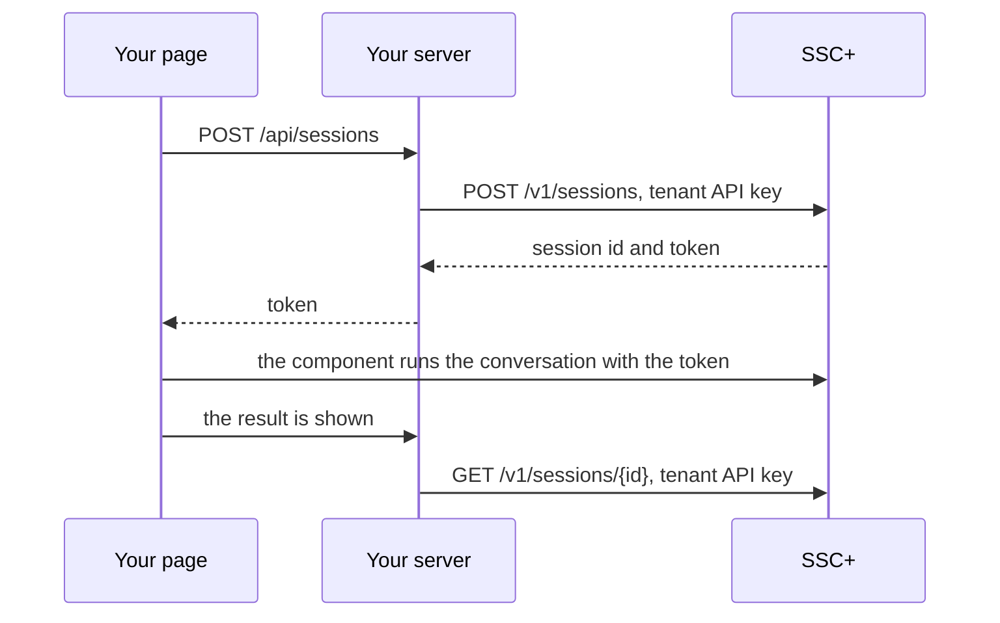

# SSC+ examples

Working examples of integrating [SSC+](https://www.ssc-plus.com), symptom assessment by voice and text.

**Talk** (`talk/`) is a spoken symptom assessment in the patient's browser. It comes in two forms:

- **the Web Component**, `<ssc-talk>` from [`@ssc-plus/talk-element`](https://www.npmjs.com/package/@ssc-plus/talk-element). It works in any page, with any framework or none, loaded by one `<script>` tag. See `talk/web-component/index.html`.
- **React**, `TalkTriage` from [`@ssc-plus/client-react`](https://www.npmjs.com/package/@ssc-plus/client-react). See `talk/react/src/main.jsx`.

Both use the same small server, `talk/server.mjs`, which does what your server does:

1. **It creates the session** with your tenant API key (`POST /v1/sessions`, channel `voice_web`) and gives the page only the session token. The tenant key never reaches a browser.
2. **It reads the result** (`GET /v1/sessions/{id}`) when the page says the component has shown it. SSC+ sends no callbacks: your systems fetch the result.



## Running it

You need Node.js 20.6 or later, and a tenant API key for SSC+'s development environment from your SSC+ contact.

```sh
npm install
cp .env.example .env      # then put your tenant API key in it
npm run build             # the React page
npm start
```

Open http://localhost:8080 for the Web Component and http://localhost:8080/react/ for React, press **Aloita oirearvio**, allow the microphone and answer aloud in Finnish. Browsers allow the microphone only on HTTPS pages and on `localhost`.

The session token works only from the page origin the session was created for: here `http://localhost:8080`. Set `ORIGIN` when you serve the example anywhere else.

## Preview

SSC+ is in preview. **It is not yet for real patients.** Use the development environment with made-up details only, never real patients or real personal data.

## Documentation

The [Talk integration guide](https://docs.dev.ssc-plus.com/talk-integration-guide) covers the whole integration: creating sessions, the component's options, what the patient sees at the end, and reading the result. The [API reference](https://docs.dev.ssc-plus.com/api-reference) describes every field.

## Licence

MIT. Using SSC+ needs a tenant API key from JST Healthcare Solutions Oy.
